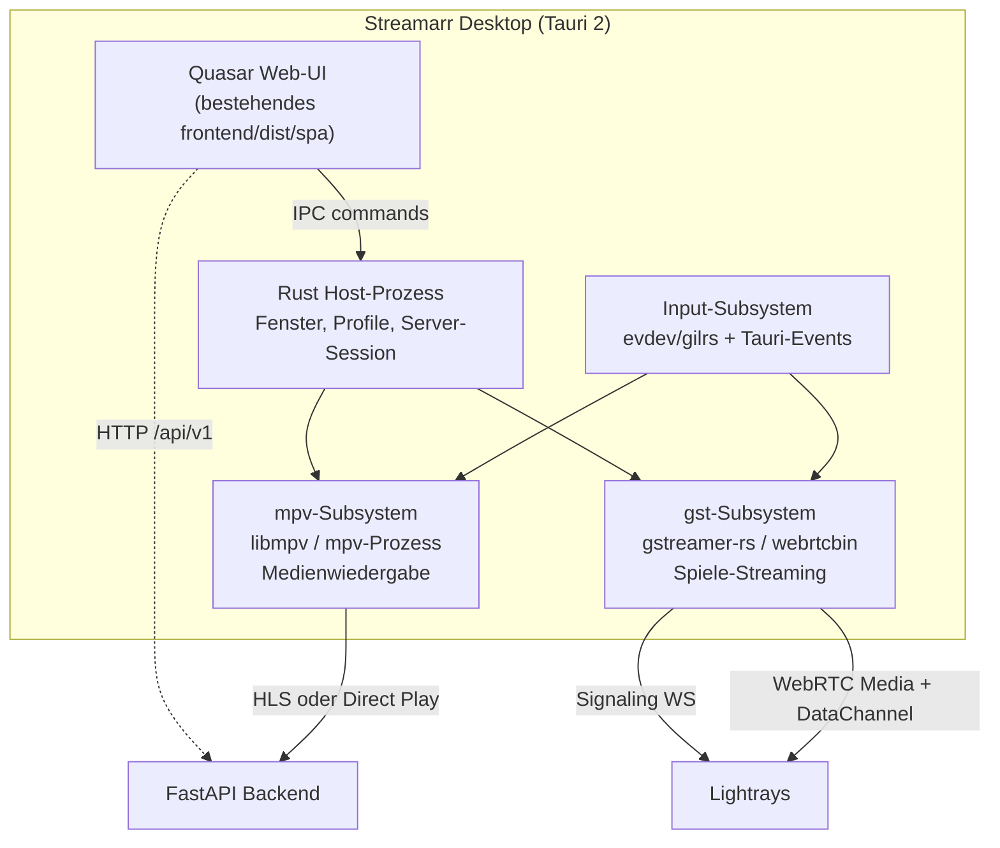

# Plan: Streamarr Desktop App

Status: In Umsetzung — Phase 0 begonnen
Datum: 2026-09-27
Zielplattformen: Linux (primär), Windows, macOS

## Umsetzungsstand

| Phase | Stand | Ergebnis |
|---|---|---|
| 0.1 GStreamer-Spike | offen | Crate-Gerüst steht (`frontend/src-tauri/player`) |
| 0.2 Fenster-Spike | **erledigt** (Linux) | [spike-02-fenster.md](spike-02-fenster.md); Gate bestanden (58–60 fps @4K), Windows-Messung offen |
| 0.3 libmpv-Spike | **erledigt** | [spike-03-mpv.md](spike-03-mpv.md); Prozess-Weg bestätigt, `--wid` entfällt |
| 0.4 Gamepad-Spike | **erledigt** | [spike-04-gamepad.md](spike-04-gamepad.md); hängende Tasten gefunden und behoben |
| 0.5 Native-Audit | **erledigt** | `isNativePlatform()` kannte nur Capacitor; Tauri-Desktop lief als „web" und persistierte keine Tokens. Behoben + 10 Tests |
| Shell-Entscheidung | **erledigt** | [ADR 001](adr-001-desktop-shell.md): Tauri bleibt, mit harter Trennung von UI und nativem Player |

**Neu angelegt:** `frontend/src-tauri/player` — shell-unabhängiges Rust-Crate für den
Player-Kern (siehe ADR 001). Enthält das Wire-Protokoll zu Lightrays, das aus
den Server-Quellen abgeleitet und durch Golden-Tests gegen genau diese Quellen
abgesichert ist. 18 Tests, CI-Eintrag in `.github/workflows/rust.yml`.

**Wichtige Korrektur am Plan:** Weg B (`--wid`-Reparenting) ist unter Wayland
nicht verfügbar (mpv#9654, mpv#1242). Weg A (Overlay-Toplevel) ist damit nicht
nur die v1-Empfehlung, sondern die einzige tragbare Variante. Siehe §4.2 und
ADR 001.

**Verifikation:** Der Frontend-Fix wurde per Vorher/Nachher-Messung gegen die
CI-Baseline geprüft: 24 fehlschlagende Tests vorher wie nachher, identische
Menge, **null neue Regressionen**. Die 9 roten Spec-Dateien sind der in
`.github/workflows/frontend.yml` dokumentierte Bestand.

**Umgebung für die Spikes:** GStreamer 1.28.5 mit `webrtcbin` und VA-API sind
vorhanden, `webkit2gtk-4.1` in der `tauri`-Distrobox, `mpv` noch nicht
(`pkg-config mpv` fehlt). Zielsystem ist **Wayland** (AMD Strix Halo) — der
Grund, warum Weg B entfällt.

## 1. Ziel und Leitplanken

Eine eigenständige Desktop-App für Streamarr, die sich in zwei Punkten an
etablierten Referenzen orientiert:

- **Medienwiedergabe → Vorbild Jellyfin Desktop (`jellyfin-desktop`).**
  Web-UI als Oberfläche, aber ein **nativer Player-Kern** (`libmpv`) statt
  HTML5-Video. Ergebnis: Direct Play von praktisch allem (HEVC, AV1, TrueHD,
  DTS, Untertitel-Formate), HDR/Dolby-Vision-Passthrough, Hardware-Decoding,
  Audio-Passthrough, kein unnötiges Transcoding.
- **Spiele-Streaming → Vorbild `moonlight-qt`.**
  Der Client dekodiert den **Video-RTP-Stream selbst** (Hardware-Decoder über
  SDL/FFmpeg) und rendert ihn in ein natives Fenster. Geringste Latenz, freie
  Codec-Wahl (H.264/HEVC/AV1), Zugriff auf echte Gamepads über `/dev/input`
  (`/dev/input/js*`, evdev), Rumble, HDR.

Der aktuelle Stand im Repo ist davon weit entfernt: `frontend/src-tauri` ist ein
nacktes Tauri-2-Gerüst (nur `tauri` + `tauri-plugin-opener`, Capabilities nur
`core:default`), das die Web-App einbettet. Für Spiele läuft bereits ein
WebRTC-Pfad im Browser (`useLightraysStreaming.js`, 641 Zeilen), der genau an
den Grenzen des Web-Ansatzes leidet (siehe §3).

Dieses Dokument ist die Umsetzungsplanung; es ändert noch keinen Code.

**4K / HDR / hohe Bildraten:** Die App *kann* das für Medien, für Spiele nur nach Serverarbeit — die vollständige Fähigkeitsmatrix und die dafür nötigen Änderungen stehen in [§10](#10-hdr-und-high-framerate-fahigkeitsmatrix). Kurzfassung: Medien-HDR kommt aus Direct Play (mpv), Spiele-HDR ist heute unmöglich, weil die Lightrays-Encoder-Pipeline 8-Bit ist.

### Nicht-Ziele (v1)

- Kein Ersatz des Web-Clients. Web bleibt voll funktionsfähig.
- Kein neuer Streaming-Server. `lightrays` und `/api/v1/stream` bleiben die
  Backends; die Desktop-App ist ein zusätzlicher Client.
- Kein eigener Store/Account-Sync. Die bestehende Device-/Session-API wird
  genutzt.
- Kein vollständiges Offline-Sync-Subsystem in v1 (Phase 4, optional).

## 2. Referenzarchitekturen — was genau übernommen wird

### 2.1 Jellyfin Desktop als Vorbild für Medien

| Aspekt | Jellyfin Desktop | Übernahme für Streamarr |
|---|---|---|
| UI | Web-UI in Qt WebEngine (CEF in v3) | Web-UI (bestehende Quasar-App) in Tauri-WebView |
| Player | **libmpv** als externer Renderer | `libmpv` in Rust via `libmpv`-Crate, Render-API |
| Einbettung | Wayland: `wl-proxy` reparented mpv-Surface als Subsurface; Windows/macOS eigene Wege | Tauri: mpv in eigenes, randloses Child-/Overlay-Fenster über dem WebView, mit Blenden-Umschaltung |
| Warum nicht Browser-`<video>` | libmpv-Render-API kann weniger als Standalone-mpv (kein `gpu-next`, HDR) → deshalb Wrapping | Gleiche Begründung: wir wollen den vollen mpv-Pfad, nicht die Render-API-Grenzen |
| Profile | `profiles/<name>/jellyfin-desktop.conf` + `mpv.conf` | `profiles/<server>/<user>/desktop.toml` + `mpv.conf` |
| Konfiguration | `mpv.conf` durchgereicht | `mpv.conf` im Profilordner, von der UI nur ergänzt |

Praktische Konsequenz: Das Frontend entscheidet weiter, *was* gespielt wird
(`/api/v1/play/{id}`-Negotiation, Playback-Profil, Resume-Position), aber der
*Abspielpfad* wird umgeschaltet auf „native" statt „HLS im `<video>`", sobald
die App im Desktop-Modus läuft und der Codec/Container vom nativen Pfad
getragen wird.

### 2.2 Moonlight-Qt als Vorbild für Spiele

| Aspekt | Moonlight-Qt | Übernahme für Streamarr |
|---|---|---|
| Transport | eigenes Protokoll (GameStream/Sunshine) | **WebRTC statt neuem Protokoll** — Lightrays spricht bereits WebRTC, inkl. Signaling und Input-Datenkanal |
| Decoding | FFmpeg/SDL Hardware-Decoder, Zero-Copy in den Renderer | `gstreamer-rs` (`webrtcbin` + `vaapidecodebin`/`nvh264dec`/`d3d11h264dec`) → `glimagesink`/`d3d11videosink` |
| Warum nicht WebView-WebRTC | — | Browser-WebRTC bringt Zwangspuffer (Jitterbuffer, Decoder-Sandbox) und keinen Zugriff auf Hardware-Decoder-Interop; Linux/WebKitGTK ist zusätzlich unzuverlässig (WebRTC nur experimentell) |
| Input | SDL2-Gamepads + SDL/evdev direkt, Rumble | Rust: `gilrs`/`evdev` direkt, Rumble über evdev FF; Maus/Tastatur über Tauri-Fenster-Events |
| Input-Transport | eigenes Protokoll | **bestehender Lightrays-Datenkanal** (`input`-Channel, Nachrichten `key`, `mouseabs`, `mousemove`, `mousebutton`, `wheel`, `gamepadbutton`, `gamepadaxis`) |
| Fokus/Pointer-Lock | natives Fenster, relativer Mausmodus | nativ, plus Pointer-Lock im Fenster |
| HUD/Statistik | Overlay mit Bitrate/FPS/Latenz | gleiche Kennzahlen, aber aus GStreamer-Stats statt `pc.getStats()` |

Entscheidend: **Lightrays bleibt der Server.** Wir tauschen nur die
Client-Seite des WebRTC-Stacks (JS/WebRTC → Rust/GStreamer) und behalten
Signaling, Launch-API, Session-IDs, Tickets und den Input-Nachrichtenvertrag
unverändert. Das ist die kleinste Änderung mit dem größten Latenzgewinn.

## 3. Warum überhaupt nativ? (Probleme des heutigen Stands)

Aus `frontend/src/composables/useLightraysStreaming.js`:

1. **WebView-WebRTC unter Linux ist unzuverlässig.** WebKitGTK liefert WebRTC
   nur mit experimentellen Features; auf den Zielsystemen ist das nicht
   garantiert verfügbar.
2. **Kein Zugriff auf Hardware-Decoder-Interop.** Der Browser dekodiert, aber
   ohne Zero-Copy in den Präsentationspfad; Latenz und GPU-Last sind schlechter
   als nötig.
3. **Gamepad nur über die Browser-Gamepad-API.** Der Code weicht inzwischen auf
   Remote-Gamepad-UDP-Pakete aus (siehe `lightrays/src/gamepad.rs`), weil
   `/dev/uinput` in verschachtelten Container-Runtimes `EPERM` liefert. Ein
   nativer Client liest Pads direkt und braucht diesen Umweg nicht.
4. **Medienpfad bleibt Browser-limitiert.** Kein HEVC/AV1 zuverlässig, kein
   echten Audio-Passthrough, Untertitel nur was der Browser kann → mehr
   Transcoding-Last auf dem Server als nötig.

## 4. Zielarchitektur



### 4.1 Prozess- und Thread-Modell

- **Host = Tauri-Prozess.** Besitzt das Hauptfenster (WebView), die Tray-Ikone,
  Global Shortcuts, Profile, Update-Check.
- **Player-Prozesse getrennt.** Medien: entweder `libmpv` in-process (Render-API
  in einen Child-Handle) oder — bevorzugt für HDR/`gpu-next` — ein
  **separater `mpv`-Prozess** mit `--wid=<child-window-id>` und
  IPC-Steuerung über `--input-ipc-server`. Der Prozessweg ist robuster
  (Absturz isoliert, Standalone-mpv-Features verfügbar) und entspricht dem
  Jellyfin-Wrapping-Ansatz.
- **GStreamer in eigenem Thread** innerhalb des Tauri-Prozesses oder in einem
  separaten Helfer-Binary `streamarr-player` (empfohlen ab Phase 3, weil
  GStreamer-Crashs dann nicht die UI mitnehmen).
- **UI bleibt reines Web.** Kein Zugriff auf Decoder/Renderer; sie fragt über
  Tauri-Commands an.

### 4.2 Fenster- und Z-Order-Strategie (der kritische Punkt)

Die WebView liegt immer oben. Für natives Video darunter braucht es einen der
drei Wege — die Auswahl ist plattformabhängig und muss in Phase 0 verifiziert
werden:

| Weg | Beschreibung | Plattformen | Risiko |
|---|---|---|---|
| **A: Overlay-Toplevel** | eigenes Fenster; **im Vollbild** über der UI, UI wird während der Wiedergabe ausgeblendet. HUD wird *in* dieses Toplevel gezeichnet | alle | Multi-Window-Handling, Fokus, Fullscreen-Wechsel |
| **B: `--wid`-Reparenting** | ~~mpv/GStreamer rendert in ein vom Host erzeugtes Kind-Fenster~~ | ~~Linux~~, Windows | **Unter Wayland nicht möglich** — siehe unten |
| **C: Airspace/Hole-Punching** | WebView transparent über nativem Swapchain (DirectComposition auf Windows) | Windows (ausgereift), macOS (ok) | Linux: nicht verfügbar |

> **Weg A ist präzisiert — Spike 0.2 hat die ursprüngliche Formulierung
> widerlegt.** Ein Wayland-Client darf seine Toplevel **nicht positionieren**:
> `gtk_window_move(120,90)` wird von GNOME/Mutter ignoriert (gemessen, siehe
> [Spike 0.2](spike-02-fenster.md)). „An die WebView-Position gepinnt" ist damit
> unter Wayland nicht umsetzbar. GNOME liefert außerdem kein `layer-shell`.
>
> Die Umsetzung hängt deshalb **nicht mehr an Koordinaten**:
>
> | Modus | Vorgehen | Trägt auf |
> |---|---|---|
> | Wiedergabe | Video-Toplevel im **Vollbild**, UI versteckt | Wayland, X11, Windows |
> | HUD/Menü über Video | im **Video-Toplevel** gezeichnet, nicht als zweites Fenster | alle |
> | Positioniertes Fenster | nur X11/Windows | X11, Windows |
>
> Das Abnahmekriterium selbst (Video sichtbar, UI ein-/ausblendbar, kein
> Flackern beim Fullscreen) ist **erfüllt**: 480 Frames ohne Aussetzer über den
> Fullscreen-Umschlag und bei versteckter UI. Sink der Wahl unter Linux ist
> **`waylandsink`** — `glimagesink` stürzt ab, wenn es GDKs `wl_surface` bekommt.

> **Weg B ist für Linux gestrichen.** `--wid` funktioniert unter Wayland nicht
> und wird es voraussichtlich nie: „It's not really possible. At least, the
> `--wid` option currently does not work on wayland and probably will never
> work (the wayland devs don't like embedding to arbitrary windows)"
> — [mpv#9654](https://github.com/mpv-player/mpv/issues/9654), ebenso
> [mpv#1242](https://github.com/mpv-player/mpv/issues/1242) („Just wayland is
> missing"). Unter Wayland bekommt mpv/GStreamer ein eigenes Toplevel;
> Jellyfin Desktop baut dafür einen `wl-proxy`, der mpv's Wayland-Verbindung
> abfängt und die Surface als Subsurface unterordnet
> ([jellyfin-desktop PR #563](https://github.com/jellyfin/jellyfin-desktop/pull/563)).
> Dieser Aufwand lohnt für uns nicht, solange Weg A trägt.

**Entscheidung:** v1 = Weg A (überall gleich, kein Plattform-Sonderweg).
Weg B nur für Windows, falls dort Weg A nicht trägt. Weg C optional für
Windows (die `wry`-DirectComposition-Arbeit und Projekte wie `airspace` zeigen,
dass das machbar ist).

Die bestehende Toolbar (Fullscreen, Match Resolution, Lock Mouse, Debug,
Disconnect) wird beim Player-Start ausgeblendet und bei Mausbewegung über dem
nativen Fenster wieder eingeblendet — die UI bleibt also die Chrome-Schicht.

### 4.3 Modul-Zuschnitt (Stand: Kern angelegt)

Der Player-Kern ist ein **eigenes Crate**, das die Shell als Pfad-Abhängigkeit
 einbindet — damit die Shell austauschbar bleibt (ADR 001) und der Kern ohne
GTK/WebKit testbar ist. Er liegt seit dem Umzug **innerhalb** von
`frontend/src-tauri/`, damit die Desktop-App einen einzigen Ort hat:

```
frontend/src-tauri/
  Cargo.toml            # Shell-Crate, hängt von `player` ab
  tauri.conf.json       # Fenster, Bundles, Rechte
  capabilities/         # pro Fenster getrennte Rechte
  src/
    main.rs
    lib.rs              # Aufbau der App, Plugin-Registrierung
    api.rs              # alle Server-Aufrufe der Shell (Pfad, nie URL)
    storage.rs          # Token-Ablage (Keyring), Dateirechte
    commands/           # IPC-Befehle: playback, game, couch, report, session,
                        # profiles, deeplink, update, bridge
    bin/                # game-live-check: Diagnose gegen den echten Server
  tests/                # Playback-Befehle gegen den Kern
  examples/             # Sonden: caps, play_live, track, update
  scripts/              # check_versions, check_bundle_deps, make_test_media,
                        # issue_test_api_key
  player/               # ← DER KERN: shell-unabhängig, kein Tauri
    src/
      lib.rs
      protocol.rs       # Wire-Vertrag zu Lightrays (golden getestet)
      plan.rs           # Wiedergabeplan, HLS-Token-Header
      mpv.rs            # Steuerung über JSON-IPC (Unix-Socket)
      mpv_caps.rs       # Fähigkeiten der installierten mpv
      playback.rs       # Lebenszyklus einer Wiedergabe
      game_pipeline.rs  # GStreamer-Pipeline
      game_session.rs   # Sitzung, Reconnect, Aufräumen
      signaling.rs      # WebSocket-Signaling, SDP-Antwort
      input.rs, pad.rs, keymap.rs, toolbar.rs   # Eingabe und Bedienleiste
      couch.rs          # Fokus-Geometrie für den Couch-Modus
      display_hdr.rs    # EDID/CTA-861, HDR-Entscheidung
      resolve_tunnel.rs # DNS-Pin und Tunnel
      session.rs, profile.rs, capabilities.rs, updater.rs, deeplink.rs
```

Die Spike-Notizen liegen unter `docs/plans/spikes/`, neben den ausführlichen
Fassungen, die sie reproduzieren.

## 5. Arbeitspakete

### Phase 0 — Fundament und Risiko-Validierung (1–1,5 Wochen)

Ziel: Die drei riskantesten Annahmen beweisen, bevor Produktivcode entsteht.

| # | Aufgabe | Ergebnis / Abnahmekriterium |
|---|---|---|
| 0.1 | **WebRTC-Client-Spike in Rust:** minimales Binary gegen einen laufenden Lightrays-Server, `gstreamer-rs`-Pipeline `webrtcsrc/webrtcbin → h264parse → decode → sink`, Signaling per WS | Bild erscheint, Latenz messbar; Dokumentation der benötigten GStreamer-Plugins pro Plattform |
| 0.2 | **Fenster-Spike:** natives Video (Dummy-Farbverlauf) in Overlay-Fenster über Tauri-WebView, Linux Wayland **und** X11, plus Windows | Video sichtbar, UI überlagerbar/ausblendbar, kein Flackern beim Fullscreen |
| 0.3 | **mpv-Spike:** Originaldatei aus `/api/stream/file?token=` in **separatem mpv-Prozess** (JSON-IPC, kein `--wid`), Steuerung (Play/Pause/Seek/Track-Auswahl), Positionsrückmeldung | Steuerung aus der UI heraus funktioniert, Position wird korrekt zurückgemeldet |
| 0.4 | **Gamepad-Spike:** `gilrs` erkennt Xbox/DS4-Pad nativ, Werte kommen im Datenkanal-Format an | Werte im Spiel sichtbar, Hotplug funktioniert |
| 0.5 | **`isNativePlatform()`-Audit:** prüfen, wo `Capacitor?.isNativePlatform()` Token-Persistenz steuert (`src/utils/authStorage.js`, `boot/axios.js`) | Entscheidung + Ticket: Tauri muss in dieselbe Verzweigung fallen (`window.__TAURI_INTERNALS__`), sonst kein persistenter Login in der Desktop-App |

Risiko-Ausgänge: Falls 0.1 auf einer Plattform nicht tragfähig ist, wird
diese Plattform in v1 auf den Web-Player zurückgestuft (Graceful Degradation,
siehe Phase 2.4).

### Phase 1 — Desktop-Fundament (1–2 Wochen)

| # | Aufgabe | Details |
|---|---|---|
| 1.1 | Tauri-Gerüst ausbauen | Plugins: `store`, `stronghold` oder OS-Keyring für Tokens, `single-instance`, `deep-link` (`streamarr://`), `updater`, `window-state`, `log` |
| 1.2 | Capabilities pro Fenster | `main` (UI) und `player` (nativ) getrennt; UI bekommt **keine** direkten Player-/Dateisystem-Rechte, nur `invoke`-Commands |
| 1.3 | Profilverwaltung | Profile = Server-URL + User + lokale Einstellungen; `mpv.conf` im Profilordner editierbar; Pfade plattformkonform |
| 1.4 | Login-Flow native | Server-URL-Eingabe (statt Origin), OIDC/Browser-Redirect zurück per Deep-Link, Token im Keyring, `X-Client-Platform`-Header korrekt setzen |
| 1.5 | Device-Registrierung | Desktop meldet `app_name = "Streamarr Desktop"`, `app_version`, Plattform; Capabilities über `PUT /api/devices/me/{guid}/capabilities` (u. a. `supported_video_codecs`, `max_resolution`) |
| 1.6 | Autoupdate + Single-Instance | Signierte Bundles, Kanal (stable/beta) |
| 1.7 | CI | Neuer Workflow `desktop.yml`: `cargo test` (Gate), `cargo clippy`/`fmt` (reporting, wie in `rust.yml` etabliert), Bundle-Build, Upload als Artefakt |

### Phase 2 — Medienwiedergabe nativ (2–3 Wochen)

| # | Aufgabe | Details |
|---|---|---|
| 2.1 | Native-Playback-Vertrag | Neues Tauri-Command-Set: `player_open(url, opts)`, `player_play/pause/seek/stop`, `player_set_audio`, `player_set_subtitle`, `player_set_speed`, `player_state` (Event-Stream) |
| 2.2 | Codec-/Container-Erkennung | Rust ermittelt `mpv`-Fähigkeiten (`--list-options`, Decoder-Liste) und meldet sie als Client-Capabilities an den Server → Transcoding-Entscheidung wird präziser als im Browser. **Datenschicht erledigt** (`frontend/src-tauri/player/src/capabilities.rs`, Golden-Tests gegen die Serverquellen); offen: Decoder-Liste zur Laufzeit aus mpv lesen statt fester Liste |
| 2.3 | Direct-Play statt HLS | `/api/v1/play/{id}` mit Desktop-Profil: wenn mpv den Stream direkt kann, wird die Datei-/Direct-Stream-URL übergeben statt HLS-Manifest; sonst HLS wie bisher |
| 2.4 | Fallback-Pfad | Feature-Flag `native_player = false` → exakt der heutige Web-Player in der WebView. Wichtig für Plattformen/Codecs, die Phase 0 nicht abdeckt |
| 2.5 | Fortschritt & Resume | Position aus mpv periodisch an die bestehenden Playback-Position-Endpunkte; Resume-Position beim Öffnen setzen; „Skip Intro/Outro" und Kapitel aus den vorhandenen Markern an mpv übergeben |
| 2.6 | Untertitel & Audio | Track-Liste aus mpv an die UI (statt Browser-TextTracks), Styling-Parameter durchgereicht, externe Untertitel-URLs aus den bestehenden Endpunkten |
| 2.7 | Watch Party | Sync über die vorhandene WebSocket-Bridge: mpv-Position als Quelle, Drift-Korrektur; Desktop wird als steuerbares Device geführt |
| 2.8 | Offline (optional) | Heruntergeladene Offline-Items (`/api/v1/devices/{guid}/offline-items`) im Profilordner ablegen, mpv spielt lokale Dateien |
| 2.9 | **HDR-Passthrough (Medien)** | `--vo=gpu-next`, `--target-colorspace-hint=yes`, HDR-Display-Erkennung, `hdr_format` aus den Metadaten an die UI, korrekte Angabe in den Client-Capabilities. Nur im Direct Play; siehe §10.2 |
| 2.10 | **HDR-Probe reparieren** | `frontend/src/composables/usePlay.js` fragt HDR mit `type: 'media-source'` ab, obwohl über WebRTC gespielt wird — die Aussage ist falsch. **Befund:** Der Server kennt HDR **gar nicht** als Client-Fähigkeit (kein Parameter in `playback_params.py`); die Entscheidung liegt deshalb vollständig beim Client. Native Seite in `capabilities.rs` umgesetzt (`supports_hdr` wird bewusst *nicht* gesendet); offen: Anbindung an die UI |

### Phase 3 — Spiele-Streaming nativ (3–4 Wochen)

| # | Aufgabe | Details |
|---|---|---|
| 3.1 | Session-Anbindung | `POST /api/v1/lightrays/launch/{media_id}` (bestehend) → `session_id`, `ws_ticket`, `websocket_url`, `ice_servers`; Auflösung = Fenstergröße × DPR, gerade Zahlen, Grenzen 64…7680/64…4320 (wie heute) |
| 3.2 | Signaling-Client | WS mit Subprotokoll `["lightrays", ticket]`, Nachrichten `offer` / `ice` / `answer` / `resize` / `container_died` — **Vertrag 1:1 wie `useLightraysStreaming.js`** |
| 3.3 | GStreamer-Pipeline | `webrtcbin` → `rtph264depay`/`rtph265depay` → `h264parse`/`h265parse` → Hardware-Decoder (`vaapidecodebin`, `nvh264dec`, `d3d11h264dec`, VideoToolbox) → `glimagesink`/`d3d11videosink`/`videosink` in Overlay-Fenster; `rtpjitterbuffer` mit kleiner Latenz, `sync=false` |
| 3.4 | Input-Client | Datenkanal `input`, Nachrichten exakt wie der Browser. Gamepads nativ (`gilrs`/`evdev`) statt `navigator.getGamepads()`; Tastatur per Scancode (`e.code`-Äquivalent); Maus absolut mit Letterbox-Korrektur bzw. relativ im Pointer-Lock |
| 3.5 | Toolbar-Parität | Fullscreen, Match Resolution (`resize`), Lock Mouse, Debug-Overlay, Disconnect, Live-Stats (Bitrate/FPS/RTT/Verluste/Decode-Zeit) — aus GStreamer-Stats statt `pc.getStats()` |
| 3.6 | Rumble/Haptik | Force-Feedback über evdev, sofern das Pad es unterstützt (Web-Client kann das nicht) |
| 3.7 | Multi-Monitor/HDR | Ausgabe auf gewähltem Monitor, HDR-Passthrough sofern Decoder und Sink es tragen |
| 3.8 | Robustheit | Reconnect bei ICE-Disconnect, sauberes `stop` an `/api/v1/lightrays/stop`, Aufräumen bei App-Crash |
| 3.9 | **Hohe Bildraten verifizieren** | 1080p120 und 1440p120 gegen die Encoder/Kernel-Latenz messen; `key-int-max={fps}` und Bitrate gehen bereits mit, das Server-Limit ist 120 fps (`lightrays/src/launch.rs`). Ergebnis in die Latenzmatrix (§7) |
| 3.10 | **HDR-Spielstreaming (Voruntersuchung)** | Nicht v1: braucht 10-Bit-Pipeline (P010), HEVC Main10, HDR-Metadaten über WebRTC und HDR-Ausgabe im Client. Eigenes Ticket mit PoC, siehe §10.3 |

**Wichtig:** Keine Änderung an Lightrays nötig. Der einzige denkbare
Server-Wunsch ist ein WebRTC-Client mit eigenem Codec-Wunsch (z. B. AV1);
das ist ein Folge-Ticket, kein Blocker.

### Phase 4 — Politur, Paketierung, Auslieferung (2 Wochen)

| # | Aufgabe | Details |
|---|---|---|
| 4.1 | Plattform-Parität | Linux: `.deb`, `.rpm`, AppImage, Flatpak-Kandidat; Windows: NSIS + MSI; macOS: `.dmg` (signiert/notarisiert) |
| 4.2 | Codec-/Abhängigkeitsstrategie | mpv und GStreamer-Plugins bündeln vs. System nutzen entscheiden (AppImage/Flatpak brauchen Bündelung; Distributionen wollen System-Libs). Dokumentieren, inkl. Lizenzlage (GPL/LGPL für mpv/GStreamer) |
| 4.3 | Barrierefreiheit & i18n | Bestehende `en-US`/`de-DE`-Locales nutzen, Desktop-spezifische Strings ergänzen; Fokus-Reihenfolge, Screenreader im UI-Teil |
| 4.4 | Doku | `docs/docs/user-guide/desktop.md` (Installation, Profile, mpv.conf, Tastenkürzel, Troubleshooting) und Entwicklerabschnitt in `docs/docs/developer-guide/overview.md` |
| 4.5 | Telemetrie/Support | Optional Logs an `/api/v1/client-logs`; „Report problem" mit Player-Logs und `mpv`/GStreamer-Version |
| 4.6 | Release-Prozess | Version synchron zu `package.json`/`Cargo.toml`, Update-Feed, Rollback-Pfad |

### Phase 5 — Optional: Konsolen-/TV-Modus

Moonlight-ähnlicher „Couch"-Einstieg: Controller-Navigation, Big-Picture-Start,
Autostart in Vollbild. Nur nach v1.

## 6. Schnittstellen-Verträge (was stabil bleiben muss)

| Vertrag | Fundstelle | Regel |
|---|---|---|
| Signaling-Nachrichten | `lightrays/src/server.rs`, `useLightraysStreaming.js` | Rust-Client implementiert exakt `offer`, `ice`, `answer`, `resize`, `container_died`, `input` |
| Input-Nachrichten | `useLightraysStreaming.js`, `lightrays/src/input.rs`, `gamepad.rs` | Feldnamen und Semantik unverändert; Native-Client liefert Scancodes/Gamepad-Indizes im selben Format |
| Launch/Stop | `backend/src/streamarr/api/v1/lightrays.py` | Kein API-Change |
| Playback-Entscheidung | `/api/v1/play`, `/api/v1/stream` | Desktop meldet erweiterte Capabilities über `/api/v1/devices/me/{guid}/capabilities` |
| Auth | `boot/axios.js`, `utils/authStorage.js`, `services/device.py` | `X-Client-Platform` und Token-Persistenz müssen Tauri als „native" erkennen |
| Device-Identität | `utils/deviceIdentity.js`, `models/device.py` | Desktop bekommt eine stabile `device_id` aus dem Profilordner, nicht aus `localStorage` |

## 7. Teststrategie

| Ebene | Umfang |
|---|---|
| Rust-Unit | Signaling-Nachrichtenparsing, Input-Mapping (Button-/Achsen-Indizes), Pipeline-Deskriptor-Auswahl, Profil-/Konfig-Laden |
| Rust-Integration | Gegen einen Lightrays-Testserver: Launch → Offer → ICE → erstes Frame; `container_died`-Pfad; Stop |
| Golden-Tests | Input-Vertrag: JS-Nachrichten vs. Rust-Nachrichten müssen byte-gleich sein (Fixture-Dateien, in beiden Sprachen geprüft) |
| E2E | Tauri-Treiber (WebDriver) für Login, Navigation, Player-Start auf den drei Plattformen |
| Manuell/Matrix | Latenz- und Korrektheitsmatrix: Codecs × GPU × Plattform; Controller-Matrix (Xbox, DS4/DS5, Switch Pro, 8BitDo) |
| Last | Parallele Streams pro Account gegen die bestehenden Limits |

Metriken für den Erfolg: Latenz (Glass-to-Glass) auf Linux ≤ 25 ms im LAN,
Drop unter 0,1 % Frames, kein Audio-Desync; Medienpfad: 0 Transcodes für
HEVC/AV1-Dateien mit passendem Client.

## 8. Aufwand und Reihenfolge (Zusammenfassung)

| Phase | Inhalt | Aufwand | Abhängigkeit |
|---|---|---|---|
| 0 | Spikes: WebRTC/gst, Fenster, mpv, Gamepad, Native-Audit | 1–1,5 Wo | keine |
| 1 | Desktop-Fundament (Auth, Profile, CI, Updates) | 1–2 Wo | 0, insb. 0.5 |
| 2 | Medien nativ (mpv) | 2–3 Wo | 0.3, 1 |
| 3 | Spiele nativ (gst + Input) | 3–4 Wo | 0.1, 0.2, 0.4 |
| 4 | Politur, Pakete, Doku | 2 Wo | 1–3 |
| 5 | Couch-Modus | optional | 4 |

Parallelisierbar: Phase 2 und Phase 3 haben getrennte Subsysteme (mpv vs.
GStreamer) und können ab Phase 1 von zwei Strängen bearbeitet werden, wenn die
Fenster-/Z-Order-Frage aus 0.2 vorher geklärt ist.

## 9. Offene Entscheidungen (vor Phase 1 zu treffen)

1. **Renderer-Einbettung** — **entschieden** (Spike 0.2): Weg A als
   Overlay-Toplevel, unter Wayland im Vollbild statt positioniert; Weg B (`--wid`)
   gestrichen. Siehe [spike-02-fenster.md](spike-02-fenster.md).
2. **libmpv in-process vs. separater Prozess** — **entschieden** (Spike 0.3):
   **separater Prozess** über JSON-IPC. 12/12 Prüfungen grün, keine native
   Link-Abhängigkeit, Crash-Isolation. Siehe [spike-03-mpv.md](spike-03-mpv.md).
3. **GStreamer im Host vs. Helfer-Binary** — Empfehlung: Helfer-Binary ab
   Phase 3.
4. **Bündelung von mpv/GStreamer** — Auswirkung auf Bundle-Größe, Lizenzen,
   Distributions-Vorgaben.
5. **Codec-Priorität** — H.264/HEVC fest, AV1 als Folge-Ticket (braucht
   Server-/Encoder-Seite in Lightrays).
6. **Plattform-Reihenfolge** — Vorschlag Linux → Windows → macOS; ggf. anders,
   je nach Zielgruppe.
7. **Desktop als „Cast-Target"** — soll die Desktop-App als steuerbares Gerät
   in der Remote-Control-Liste erscheinen (`/api/v1/devices/.../commands`)?
   Naheliegend ja, aber eigenes Ticket.
8. **HDR-Strategie für Transcodes** — HDR-Verlust im UI anzeigen (Empfehlung für
   v1) oder Backend um Tonemapping/HDR-erhaltenden Transcode erweitern (§10.2).

## 10. HDR- und High-Framerate-Fähigkeitsmatrix

Die Frage „kann die App 4K HDR und hohe fps?“ hat zwei verschiedene Antworten,
je nach Pfad. Medien und Spiele unterscheiden sich hier grundlegend, weil der
Medienpfad die Datei nur *durchreicht*, während der Spielpfad das Bild *selbst
kodiert*.

### 10.1 Matrix (Ist-Stand heute)

| | Medien, Direct Play | Medien, Transcode | Spiele (Lightrays) |
|---|---|---|---|
| **Auflösung** | bis 8K, was Display/GPU tragen | bis Label `4k` (2160p), Server-Cap über `transcoding.max_resolution` | bis 7680×4320 — `lightrays/src/launch.rs` (`MAX_WIDTH`/`MAX_HEIGHT`) |
| **HDR10 / HLG** | **ja** (mpv-Passthrough) | **nein** — Transcoding im Backend ist HDR-blind (kein `zscale`/`tonemap`, keine 10-Bit-Ausgabe im Repo) | **nein** — Encoder nur NV12/I420 8-Bit |
| **Dolby Vision** | **ja**, abhängig vom Profil (5 vs. 8.x) | nein | nein |
| **Hohe fps** | ja, bis Display-/GPU-Grenze (24–120+) | ja, aber Encoder-Kosten | **ja, bis 120 fps** (`MAX_FPS = 120`) |
| **Bitrate** | egal (lokal/Netz) | begrenzt durch Encoder + `transcoding`-Settings | max. 50 000 kbps (`MAX_BITRATE_KBPS`) |
| **Audio** | Passthrough (TrueHD/Atmos, DTS:X) möglich | re-encode (Verlust) | Opus |

Kurz: **Medien ja (im Direct Play), Spiele-HDR nein — auch mit der neuen App
nicht, ohne Lightrays umzubauen.** Hohe fps sind in beiden Pfaden heute schon
möglich.

### 10.2 Medien: was zu tun ist, damit 4K HDR wirklich ankommt

Der native Player ist genau der Hebel: mpv mit `gpu-next` kann HDR10/HLG
passthrough und HDR→SDR-Tonemapping, was der Web-Player in der WebView nicht
kann (Browser-HEVC über WebRTC ist praktisch nicht verfügbar; die eigene
Encoder-Notiz in `lightrays/src/encoder.rs` sagt das explizit für WebRTC).

Aufgaben:

1. **Direct Play erzwingen, wo möglich.** HDR überlebt nur, wenn nicht
transkodiert wird. Der Desktop-Client meldet dafür präzise Fähigkeiten
   (`/api/v1/devices/me/{guid}/capabilities`): HEVC/AV1, `max_resolution: 4k`,
   Audio-Codecs, HDR-Fähigkeit. Der Server kennt das Feld `hdr_format` bereits
   (`backend/src/streamarr/libraries/base.py`, `api/v1/libraries.py`).
2. **mpv konfigurieren.** `--vo=gpu-next`, `--target-colorspace-hint=yes`
   (HDR-Passthrough an das Display), HDR-Display-Erkennung, sinnvolle
   Tonemapping-Optionen als Fallback auf SDR-Displays. Diese Optionen gehören
   in das Profil-`mpv.conf` und werden von der UI nur überschrieben, wo nötig.
3. **Die HDR-Probe im Frontend ersetzen.** `usePlay.js` fragt
   `navigator.mediaCapabilities.decodingInfo` mit `type: 'media-source'` ab,
   obwohl der WebRTC-Pfad gespielt wird — die Antwort ist systematisch falsch.
   Im Desktop-Modus muss die Capability vom nativen Kern kommen.
4. **Transcode-Pfad dokumentieren oder ertüchtigen.** Wenn transkodiert wird,
   ist HDR verloren. Zwei Optionen: (a) dokumentieren und im UI anzeigen
   („HDR wird bei Transcoding auf SDR abgebildet"), oder (b) Backend-Arbeit:
   Tonemapping (`zscale`/`libplacebo`) und optional HDR-erhaltender
   HEVC-Main10-Transcode. Empfehlung: (a) in v1, (b) als eigenes Ticket.

### 10.3 Spiele: warum HDR heute nicht geht und was es kosten würde

Die Beweislage im Repo ist eindeutig:

- `lightrays/src/encoder.rs` führt nur Encoder für 8-Bit-Pfade
  (`vah264enc`, `vaapih264enc`, `nvh264enc`, `x264enc` bzw. deren H.265-Pendants)
  und baut die Pipelines über `videoconvert ! video/x-raw,format=NV12` bzw.
  `format=I420`.
- Die ausgehenden Caps sind `video/x-h264,profile=constrained-baseline` bzw.
  `video/x-h265,profile=main` — **kein Main10, kein `P010_10LE`**.
- `select_encoder()` gibt unabhängig von der Breite immer H.264 zurück, weil
  Browser kein HEVC über WebRTC können.

Ein HDR-Spielstream braucht daher:

1. **10-Bit-Pipeline serverseitig:** Compositor-Ausgabe als `P010_10LE`,
   `vah265enc`/`nvh265enc` mit `profile=main-10`, Bitrate/Rate-Control neu
   abgestimmt (HDR10 braucht spürbar mehr Bitrate).
2. **Codec-Wechsel weg von H.264:** HDR10 über H.264 ist nicht praktikabel.
   Der native Client macht das möglich, weil wir beide Enden kontrollieren —
   `webrtcbin` trägt laut GStreamer-Doku H.265 und AV1 (`video-caps`).
3. **HDR-Metadaten über die Leitung:** statische (Mastering Display /
   MaxCLL) und ggf. dynamische Metadaten müssen im Stream mitlaufen; WebRTC
   hat dafür nur schwache Standardisierung, also eigenes SEI-/Container-
   Handling.
4. **Client-seitig:** 10-Bit-Decoder, HDR-Ausgabe in den Overlay-Renderer
   (bzw. `--target-colorspace-hint`-Äquivalent), Display-HDR-Umschaltung.
5. **Container-/Spiele-seitig:** gamescope/Compositor muss HDR liefern können
   (Games-on-Whales-Image, Compositor-Ausgabeformat).

Das ist ein eigenes Projekt (grob 4–8 Wochen inkl. Testmatrix), kein Anhang an
Phase 3. Empfehlung: v1 ohne Spiel-HDR ausliefern, HDR10-Spielstreaming als
eigene Phase nach Phase 4 mit vorangestelltem PoC. Hohe fps sind davon
unabhängig und in v1 erreichbar.

### 10.4 Realistische Erwartung an den Nutzer

- 4K HDR Filme/Serien: **ja**, sofern Direct Play möglich ist (Bandbreite,
  Codec, Audio) und Display/GPU HDR können.
- 4K HDR Spiele: **nein** in v1 — unabhängig vom Client, solange Lightrays
  8-Bit H.264 sendet.
- Hohe fps: **ja** in beiden Pfaden; 4K120 ist praktisch durch Encoder-Latenz,
  Bitrate und Client-Decoder begrenzt und sollte vor dem Versprechen gemessen
  werden (Aufgabe 3.9).

## 11. Konkrete erste Schritte (nächste Sitzung)

1. Spike-Branch anlegen, minimalen `gstreamer-rs`-Client gegen den lokalen
   Lightrays-Server bauen (0.1).
2. `docs/plans/desktop-app.md` in die MkDocs-Navigation unter „Development"
   aufnehmen, sobald der Plan steht.
3. Native-Audit aus 0.5 abschließen und Ergebnis hier nachtragen.
4. Tickets für Phase 0 aus diesem Dokument schneiden (ein Ticket pro Spike).
